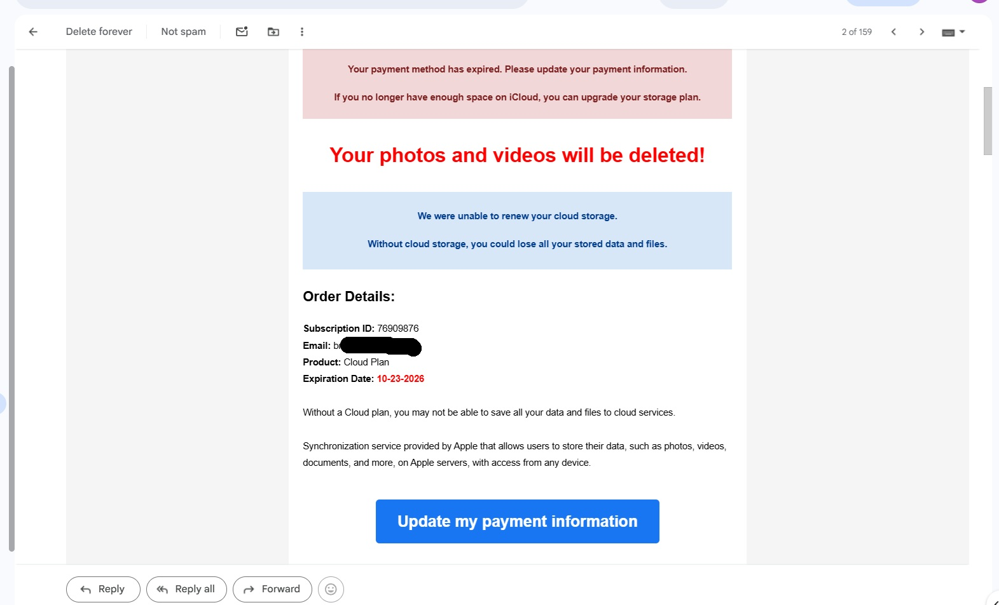
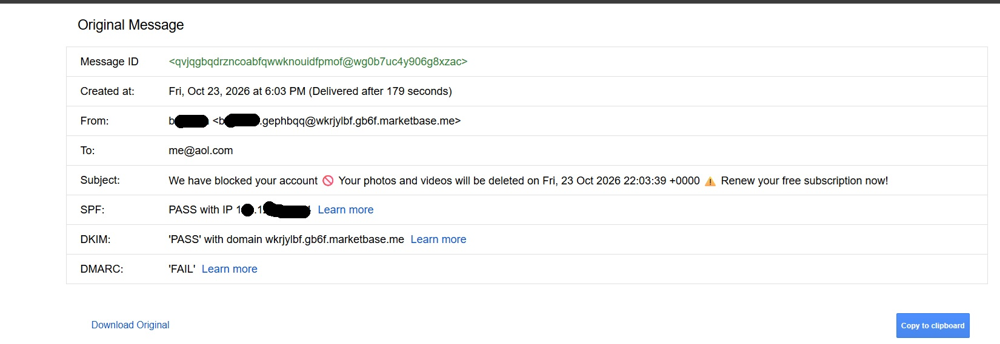
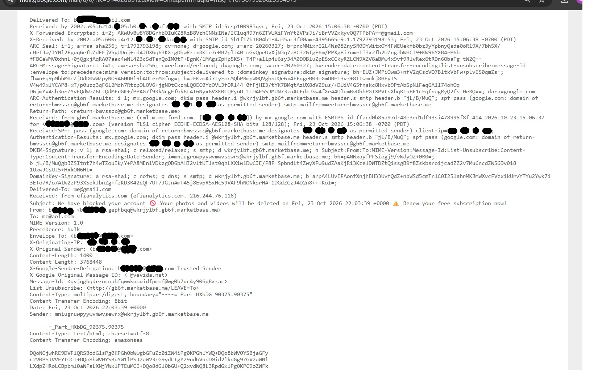
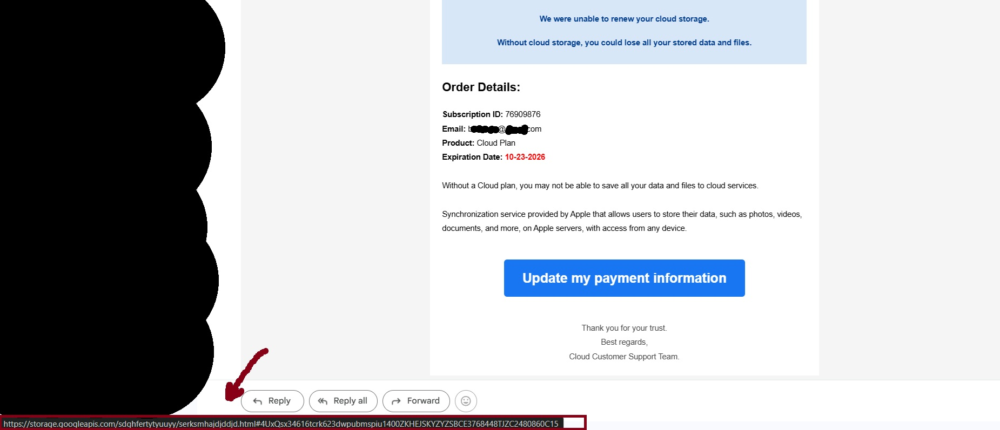
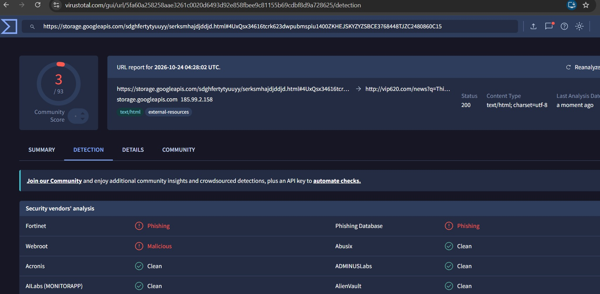

# Phishing Email Investigation

## Objective
Investigate a real phishing email received in a personal spam folder, using email header analysis, URL de-obfuscation, and threat intelligence lookups, and map the attack to the MITRE ATT&CK framework.

## Scope & Safety Notes
- No links were clicked and no attachments were downloaded or executed at any point.
- The suspicious URL was only ever copied as text and submitted to VirusTotal for sandboxed analysis.
- Personal identifying information (email addresses, account details) has been redacted from all screenshots.

## Methodology

**1. Identified a suspicious email**
Received an email impersonating Apple/iCloud, warning that "your photos and videos will be deleted" unless payment information was updated — a classic urgency/fear-based social engineering lure.

**2. Checked SPF, DKIM, and DMARC results**
Using Gmail's "Show Original" feature, authentication results showed:
- **SPF: PASS**
- **DKIM: PASS** (for domain `wkrjylbf.gb6f.marketbase.me`)
- **DMARC: FAIL**

This is a key finding: SPF and DKIM passed, but only for the *sender's own domain* (`marketbase.me`), which has no relation to Apple or iCloud. A passing SPF/DKIM check does not mean an email is legitimate — it only confirms the message wasn't spoofed *relative to the domain that actually sent it*. The DMARC failure and domain mismatch are the real indicators of abuse.

**3. Reviewed the raw header and Received chain**
Examined the full header to trace the message's path. The `Received` chain showed relay infrastructure (`efianalytics.com`, `vevida.net`) consistent with bulk/commodity phishing send infrastructure rather than a legitimate Apple mail server.

**4. Compared displayed link text to the actual URL**
The email displayed a button labeled "Update my payment information." Hovering over it (without clicking) revealed the actual destination: `storage.googleapis.com/[random-id]/....html`. This is a case of **trusted-domain abuse** — Google Cloud Storage is a legitimate service being used to host attacker-controlled content, which helps the link evade simple domain-reputation filters.

**5. Submitted the URL to VirusTotal (sandboxed, no direct access)**
Copied the URL (never opened it directly) and submitted it to VirusTotal for analysis. The scan showed the URL redirects to `http://vip620.com/news?q=...`, and **3 out of 93 security vendors** (Fortinet, Webroot, Phishing Database) flagged it as phishing/malicious.

## Findings

| Indicator | Observation |
|---|---|
| Claimed sender | Apple / iCloud |
| Actual sending domain | `wkrjylbf.gb6f.marketbase.me` |
| SPF | PASS (for attacker's own domain) |
| DKIM | PASS (for attacker's own domain) |
| DMARC | **FAIL** |
| Displayed link text | "Update my payment information" |
| Actual link target | `storage.googleapis.com` → redirects to `vip620.com` |
| VirusTotal detection | 3 / 93 vendors flagged as phishing/malicious |
| Social engineering tactic | Urgency + fear of data loss |

## MITRE ATT&CK Mapping
**T1566.002 – Phishing: Spearphishing Link**
A link-based phishing email using brand impersonation and a disguised URL to drive the recipient to a credential-harvesting or malicious landing page.

## Recommended Response
- Block the sending domain (`marketbase.me` and subdomains) at the email gateway.
- Submit the final redirect URL (`vip620.com`) for blocklisting.
- Do not click the link or enter any information on the linked page.
- Report the message as phishing and delete.

## Lessons Learned
- **SPF/DKIM passing is not proof of legitimacy.** These checks validate the sending domain's own authentication, not whether that domain is trustworthy or related to the brand being impersonated. DMARC alignment and sender domain reputation matter more.
- **Legitimate cloud services can be abused to host phishing content.** A link pointing to a well-known domain (`storage.googleapis.com`) is not automatically safe — the full URL path and final redirect must be checked.
- **Low AV/URL-scanner detection does not mean a URL is safe.** New or low-volume phishing campaigns are often not yet flagged by most vendors; a small number of detections should still be treated as a strong warning sign, not dismissed.
